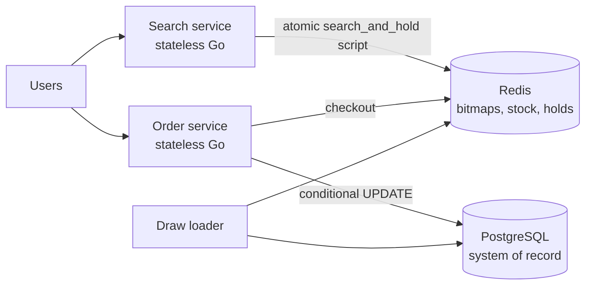

# Backend Golang Coding Test

| Part | Deliverable |
| --- | --- |
| 1. User Management API | Code in this repository; see [Part 1](#part-1-user-management-api) |
| 2. Lottery Search System | Design only (no code): summary in [Part 2](#part-2-lottery-search-system), full design in [docs/lottery-search-design.md](docs/lottery-search-design.md) |

## Part 1: User Management API

A RESTful (and gRPC) user management service in Go, backed by MongoDB, with JWT (HS256) authentication. It uses a hexagonal (ports and adapters) structure.

### Contents

- [Features](#features)
- [Project structure](#project-structure)
- [Quick start](#quick-start)
- [Configuration](#configuration)
- [JWT guide](#jwt-guide)
- [REST API](#rest-api)
- [gRPC API](#grpc-api)
- [Testing](#testing)
- [Design decisions and assumptions](#design-decisions-and-assumptions)

### Features

| Requirement | Where |
| --- | --- |
| User model (ID, Name, Email unique, hashed Password, CreatedAt) | `internal/core/domain/user.go`, `internal/adapter/outbound/mongodb` |
| Register / login returning a JWT | `internal/core/service/auth_service.go`, `POST /api/v1/auth/*` |
| JWT middleware, HS256 with secret key | `internal/adapter/inbound/httpapi/middleware.go`, `internal/adapter/outbound/security/jwt.go` |
| Create, get, list, update (name/email), delete | `internal/core/service/user_service.go`, `/api/v1/users` |
| Official MongoDB Go driver (v2) | `internal/adapter/outbound/mongodb` |
| Logging middleware (method, path, status, duration) | `httpapi.Logging` |
| Goroutine that logs the user count every 10s | `internal/adapter/inbound/scheduler/user_count.go` |
| Unit tests with `testing` and mocked MongoDB | `*_test.go`, `internal/mocks` |
| **Bonus:** Docker + docker-compose | `Dockerfile`, `docker-compose.yml` |
| **Bonus:** interface abstraction of MongoDB | `port.UserRepository` |
| **Bonus:** input validation | `internal/core/domain/user.go` |
| **Bonus:** graceful shutdown with `context.Context` | `cmd/api/main.go` |
| **Bonus:** gRPC `CreateUser` / `GetUser`, secured with token metadata | `api/proto/user/v1/user.proto`, `internal/adapter/inbound/grpcapi` |
| **Bonus:** hexagonal architecture | see below |
| Object-level authorization (users may modify only their own account) | `service.authorizeSelf` |
| Pagination on `GET /users` | `domain.Page`, `httpapi.parsePage` |
| `Idempotency-Key` support on create endpoints | `httpapi.Idempotency`, `mongodb.IdempotencyStore` |
| OpenAPI 3.1 contract for the REST API | `api/openapi.yaml` |

### Project structure

```text
.
├── cmd/api/main.go                    # composition root: wiring, servers, graceful shutdown
├── api/openapi.yaml                   # REST contract (OpenAPI 3.1)
├── api/proto/user/v1/user.proto       # gRPC contract
├── gen/user/v1/                       # generated protobuf / gRPC code
└── internal/
    ├── core/                          # ── business logic, no framework/driver imports
    │   ├── domain/                    # User entity, validation rules, domain errors
    │   ├── port/                      # interfaces: driven (repository, hasher, tokens) and driving (use cases)
    │   └── service/                   # use cases: UserService, AuthService
    ├── adapter/
    │   ├── inbound/                   # ── driving adapters (call into the core)
    │   │   ├── httpapi/               # REST handlers; JWT, idempotency, logging, recover middleware
    │   │   ├── grpcapi/               # gRPC server, auth + logging interceptors
    │   │   └── scheduler/             # background user-count reporter
    │   └── outbound/                  # ── driven adapters (called by the core)
    │       ├── mongodb/               # UserRepository and IdempotencyStore on the official driver
    │       └── security/              # bcrypt hasher, HS256 JWT service
    ├── config/                        # environment configuration
    └── mocks/                         # hand-written port mocks + in-memory repository and idempotency store
```

Dependencies point inward only: `adapter → core/port ← core/service → core/domain`. The core never imports MongoDB, `net/http`, gRPC or JWT libraries, so any adapter can be swapped or mocked.

### Quick start

#### Option A: Docker Compose (API + MongoDB)

```bash
cp .env.example .env          # then set JWT_SECRET to a random value (≥ 32 bytes)
docker compose up --build
```

- REST: `http://localhost:8080`
- gRPC: `localhost:9090`
- MongoDB: `localhost:27017`

#### Option B: run locally

Requires Go 1.27+ and a running MongoDB.

```bash
docker run -d --name mongo -p 27017:27017 mongo:8.0    # or any MongoDB instance

export JWT_SECRET="$(openssl rand -base64 48)"
export MONGO_URI="mongodb://localhost:27017"
go run ./cmd/api
```

PowerShell:

```powershell
$env:JWT_SECRET = "replace-with-a-random-string-of-at-least-32-bytes"
$env:MONGO_URI  = "mongodb://localhost:27017"
go run ./cmd/api
```

Every 10 seconds the log shows:

```json
{"time":"2026-10-25T08:00:10Z","level":"INFO","msg":"total users","count":2}
```

Press `Ctrl+C` (SIGINT) or send SIGTERM to shut down gracefully. In-flight HTTP and gRPC requests are drained, the background job stops, and the MongoDB client disconnects.

### Configuration

All settings come from environment variables.

| Variable | Default | Description |
| --- | --- | --- |
| `JWT_SECRET` | **required** | HMAC key for HS256. Must be at least 32 bytes. |
| `JWT_TTL` | `24h` | Token lifetime (Go duration). |
| `JWT_ISSUER` | `user-management-api` | `iss` claim; verified on every request. |
| `MONGO_URI` | `mongodb://localhost:27017` | MongoDB connection string. |
| `MONGO_DATABASE` | `user_management` | Database name. |
| `HTTP_ADDR` | `:8080` | REST listen address. |
| `GRPC_ADDR` | `:9090` | gRPC listen address. |
| `BCRYPT_COST` | `12` | bcrypt work factor. |
| `USER_COUNT_INTERVAL` | `10s` | Interval of the user-count log job. |
| `SHUTDOWN_TIMEOUT` | `15s` | Maximum time to drain requests on shutdown. |
| `IDEMPOTENCY_RETENTION` | `24h` | How long `Idempotency-Key` results are kept (MongoDB TTL index). Must outlive the longest client retry window. |

### JWT guide

#### 1. Get a token

Register (once), then log in:

```bash
curl -s -X POST localhost:8080/api/v1/auth/register \
  -H 'Content-Type: application/json' \
  -d '{"name":"Alice","email":"alice@example.com","password":"password123"}'

curl -s -X POST localhost:8080/api/v1/auth/login \
  -H 'Content-Type: application/json' \
  -d '{"email":"alice@example.com","password":"password123"}'
```

```json
{
  "access_token": "eyJhbGciOiJIUzI1NiIsInR5cCI6IkpXVCJ9.eyJlbWFpbCI6ImFsaWNlQGV4YW1wbGUuY29tIiwiaXNzIjoidXNlci1tYW5hZ2VtZW50LWFwaSIsInN1YiI6IjY3MWI...",
  "token_type": "Bearer",
  "expires_at": "2026-10-26T08:00:00Z",
  "user": {
    "id": "671b1f0e8c3a4d2b9e5f7a10",
    "name": "Alice",
    "email": "alice@example.com",
    "created_at": "2026-10-25T08:00:00Z"
  }
}
```

#### 2. Use the token

Send it in the `Authorization` header on every `/api/v1/users` request:

```bash
TOKEN=$(curl -s -X POST localhost:8080/api/v1/auth/login \
  -H 'Content-Type: application/json' \
  -d '{"email":"alice@example.com","password":"password123"}' | jq -r .access_token)

curl -s localhost:8080/api/v1/users -H "Authorization: Bearer $TOKEN"
```

For gRPC, send the same value as the `authorization` metadata key.

#### 3. What is inside the token

Header `{"alg":"HS256","typ":"JWT"}`; payload:

| Claim | Meaning |
| --- | --- |
| `sub` | User ID |
| `email` | User email at login time |
| `iss` | `JWT_ISSUER` |
| `iat`, `nbf` | Issued-at / not-before |
| `exp` | Expiry (`iat + JWT_TTL`) |

#### 4. How tokens are validated

The middleware rejects a request with `401` and `WWW-Authenticate: Bearer` when:

- the header is missing or not `Bearer <token>`
- the signature does not match `JWT_SECRET`
- `alg` is anything other than `HS256` (blocks `alg: none` and algorithm-confusion attacks)
- `exp` is missing or in the past, `iat` is in the future, or `iss` is wrong
- the user in `sub` no longer exists (deleting a user revokes their tokens immediately)

### REST API

The machine-readable contract is [`api/openapi.yaml`](api/openapi.yaml) (OpenAPI 3.1).

Base URL: `http://localhost:8080`. All bodies are JSON. Unknown JSON fields are rejected, and bodies are limited to 1 MiB.

| Method | Path | Auth | Description | Success |
| --- | --- | --- | --- | --- |
| `GET` | `/healthz` | — | Liveness check | `200` |
| `POST` | `/api/v1/auth/register` | — | Register a user | `201` |
| `POST` | `/api/v1/auth/login` | — | Get a JWT | `200` |
| `POST` | `/api/v1/users` | JWT | Create a user | `201` |
| `GET` | `/api/v1/users?page=1&page_size=20` | JWT | List users, oldest first, paginated | `200` |
| `GET` | `/api/v1/users/{id}` | JWT | Get a user by ID | `200` |
| `PATCH` | `/api/v1/users/{id}` | JWT, **own account only** | Update name and/or email | `200` |
| `DELETE` | `/api/v1/users/{id}` | JWT, **own account only** | Delete your account | `204` |

**Authorization.** Any authenticated user may read users. `PATCH` and `DELETE` are allowed only when `{id}` is the caller's own ID (the token's `sub`). For any other `{id}` they return `403`, whether or not that user exists, so the response does not reveal which IDs exist.

**Pagination.** `page` (default 1) and `page_size` (default 20, max 100). Results are ordered by `created_at` ascending, with ties broken by ID, so pages are stable. A page past the end returns an empty `data` array.

#### Retry semantics

| Endpoint | Safe to retry? | Behaviour |
| --- | --- | --- |
| `GET` (all) | Yes | Read-only |
| `POST /auth/login` | Yes | Each call issues a new token |
| `PATCH /users/{id}` | Yes | Idempotent: same body, same result |
| `POST /auth/register`, `POST /users` | **Only with `Idempotency-Key`** | Without a key, a retry after a lost response returns `409 email_exists`, which cannot be told apart from a genuine conflict. See below. |
| `DELETE /users/{id}` | Yes, with care | Deleting revokes the caller's tokens, so a retry after a lost `204` returns `401`. Treat `401` on a retried `DELETE` as "already deleted". |

**`Idempotency-Key`** (optional header on both create endpoints, at most 255 characters):

- **How to use it:** generate the key once per intent (for example a UUID) and reuse it on every retry of that intent. Keys are scoped to method, path and caller, and kept for `IDEMPOTENCY_RETENTION` (24h).
- **Claiming is atomic.** It is a single insert guarded by MongoDB's unique `_id` index, not a check followed by an insert.

| Situation | Response |
| --- | --- |
| First request with the key | Executed normally; the response (including 4xx) is stored |
| Retry with the same key and the same body | The stored response is replayed, with header `Idempotent-Replayed: true` |
| Same key, different body | `422 idempotency_key_reused` |
| Same key while the first request is still running | `409 request_in_progress` |
| The first attempt failed with `5xx` | Not stored, so the retry runs again |
| The first attempt crashed mid-request | Its claim is taken over after 30s. This is safe because the unique email index still prevents a duplicate user. |

#### Validation rules

| Field | Rule |
| --- | --- |
| `name` | Required, trimmed, 1–100 characters |
| `email` | Required, valid address (`local@domain.tld`), trimmed and lower-cased, unique |
| `password` | Required, 8 characters to 72 bytes (bcrypt limit) |

#### Error format

```json
{
  "error": {
    "code": "validation_error",
    "message": "request validation failed",
    "fields": { "email": "must be a valid email address" }
  }
}
```

Every error, including unknown routes and wrong methods, uses this shape:

- **`code`** is stable; branch on it.
- **`message`** is for humans and may change.
- **`fields`** lists per-field problems.

All messages are the API's own wording, never raw Go error text.

| Status | `code` | When |
| --- | --- | --- |
| `400` | `bad_request` | Body is not valid JSON, is empty or too large, has a wrong-typed field or an unknown field (named in `fields`), or `Idempotency-Key` is too long |
| `401` | `unauthorized` | Missing, invalid or expired token |
| `401` | `invalid_credentials` | Wrong email or password at login |
| `403` | `forbidden` | `PATCH`/`DELETE` on another user's account |
| `404` | `not_found` | User does not exist (or ID is malformed), or the route does not exist |
| `405` | `method_not_allowed` | Route exists under another method (the `Allow` header lists them) |
| `409` | `email_exists` | Email already used by another user |
| `409` | `request_in_progress` | Same `Idempotency-Key` is still being processed |
| `422` | `validation_error` | Well-formed JSON whose values failed validation, including bad `page`/`page_size` |
| `422` | `idempotency_key_reused` | `Idempotency-Key` reused with a different body |
| `500` | `internal_error` | Unexpected error (details are logged, never returned) |

#### Samples

**Register**

```http
POST /api/v1/auth/register
Content-Type: application/json

{"name": "Alice", "email": "Alice@Example.com", "password": "password123"}
```

```http
HTTP/1.1 201 Created
Location: /api/v1/users/671b1f0e8c3a4d2b9e5f7a10

{"id":"671b1f0e8c3a4d2b9e5f7a10","name":"Alice","email":"alice@example.com","created_at":"2026-10-25T08:00:00Z"}
```

**Register with a taken email**

```http
HTTP/1.1 409 Conflict

{"error":{"code":"email_exists","message":"email already exists"}}
```

**Register with invalid values**

```http
HTTP/1.1 422 Unprocessable Entity

{"error":{"code":"validation_error","message":"request validation failed","fields":{"email":"must be a valid email address","name":"is required","password":"must be at least 8 characters"}}}
```

**Register safely retryable with `Idempotency-Key`**

```bash
curl -i -X POST localhost:8080/api/v1/auth/register \
  -H 'Content-Type: application/json' -H 'Idempotency-Key: 9b1f6c1e-3d4a-4f7e-9a51-1f0b7f2d8c11' \
  -d '{"name":"Carol","email":"carol@example.com","password":"password123"}'
# Sending the identical request again returns the same 201 and body, plus:
# Idempotent-Replayed: true
```

**Login with a wrong password**

```http
HTTP/1.1 401 Unauthorized

{"error":{"code":"invalid_credentials","message":"invalid email or password"}}
```

**Create a user**

```bash
curl -s -X POST localhost:8080/api/v1/users \
  -H "Authorization: Bearer $TOKEN" -H 'Content-Type: application/json' \
  -d '{"name":"Bob","email":"bob@example.com","password":"password123"}'
```

```json
{"id":"671b1f2a8c3a4d2b9e5f7a11","name":"Bob","email":"bob@example.com","created_at":"2026-10-25T08:01:00Z"}
```

**List users**

```bash
curl -s 'localhost:8080/api/v1/users?page=1&page_size=20' -H "Authorization: Bearer $TOKEN"
```

```json
{
  "data": [
    {"id":"671b1f0e8c3a4d2b9e5f7a10","name":"Alice","email":"alice@example.com","created_at":"2026-10-25T08:00:00Z"},
    {"id":"671b1f2a8c3a4d2b9e5f7a11","name":"Bob","email":"bob@example.com","created_at":"2026-10-25T08:01:00Z"}
  ],
  "pagination": {"page":1,"page_size":20,"total_items":2,"total_pages":1}
}
```

**Get a user**

```bash
curl -s localhost:8080/api/v1/users/671b1f2a8c3a4d2b9e5f7a11 -H "Authorization: Bearer $TOKEN"
```

```json
{"id":"671b1f2a8c3a4d2b9e5f7a11","name":"Bob","email":"bob@example.com","created_at":"2026-10-25T08:01:00Z"}
```

**Update your own account** (send `name`, `email` or both; `$TOKEN` is Alice's)

```bash
curl -s -X PATCH localhost:8080/api/v1/users/671b1f0e8c3a4d2b9e5f7a10 \
  -H "Authorization: Bearer $TOKEN" -H 'Content-Type: application/json' \
  -d '{"name":"Alice Smith"}'
```

```json
{"id":"671b1f0e8c3a4d2b9e5f7a10","name":"Alice Smith","email":"alice@example.com","created_at":"2026-10-25T08:00:00Z"}
```

**Update someone else's account**

```bash
curl -i -X PATCH localhost:8080/api/v1/users/671b1f2a8c3a4d2b9e5f7a11 \
  -H "Authorization: Bearer $TOKEN" -H 'Content-Type: application/json' \
  -d '{"name":"Hacked"}'
```

```http
HTTP/1.1 403 Forbidden

{"error":{"code":"forbidden","message":"you can only modify your own account"}}
```

**Update with a field that cannot be changed**

```http
HTTP/1.1 400 Bad Request

{"error":{"code":"bad_request","message":"request body contains an unknown field","fields":{"password":"is not allowed"}}}
```

**Delete your own account**

```bash
curl -i -X DELETE localhost:8080/api/v1/users/671b1f0e8c3a4d2b9e5f7a10 -H "Authorization: Bearer $TOKEN"
```

```http
HTTP/1.1 204 No Content
```

**Unknown route / wrong method**

```http
HTTP/1.1 405 Method Not Allowed
Allow: POST

{"error":{"code":"method_not_allowed","message":"method not allowed for this route"}}
```

**Request without a token**

```http
HTTP/1.1 401 Unauthorized
WWW-Authenticate: Bearer

{"error":{"code":"unauthorized","message":"missing or malformed Authorization header"}}
```

#### Request log

Each request produces one structured log line:

```json
{"time":"2026-10-25T08:01:00Z","level":"INFO","msg":"http request","method":"POST","path":"/api/v1/users","status":201,"duration":71234500}
```

`duration` is in nanoseconds (slog's JSON encoding of `time.Duration`).

### gRPC API

Service `user.v1.UserService` on `:9090` (`api/proto/user/v1/user.proto`):

- `CreateUser(name, email, password) → User`
- `GetUser(id) → User`

Both RPCs require `authorization: Bearer <jwt>` metadata. Errors map to gRPC codes: `InvalidArgument`, `NotFound`, `AlreadyExists`, `Unauthenticated` and `Internal`.

Example with [grpcurl](https://github.com/fullstorydev/grpcurl):

```bash
grpcurl -plaintext -import-path api/proto -proto user/v1/user.proto \
  -H "authorization: Bearer $TOKEN" \
  -d '{"name":"Carol","email":"carol@example.com","password":"password123"}' \
  localhost:9090 user.v1.UserService/CreateUser

grpcurl -plaintext -import-path api/proto -proto user/v1/user.proto \
  -H "authorization: Bearer $TOKEN" \
  -d '{"id":"671b1f0e8c3a4d2b9e5f7a10"}' \
  localhost:9090 user.v1.UserService/GetUser
```

```json
{
  "user": {
    "id": "671b1f0e8c3a4d2b9e5f7a10",
    "name": "Alice",
    "email": "alice@example.com",
    "createdAt": "2026-10-25T08:00:00Z"
  }
}
```

To regenerate code after editing the proto, run `make proto` (requires `protoc`, `protoc-gen-go` and `protoc-gen-go-grpc`).

### Testing

```bash
go test ./...              # unit tests
go test -race -cover ./... # with race detector (needs cgo) and coverage
```

| Package | What is tested | How MongoDB is replaced |
| --- | --- | --- |
| `core/domain` | Validation, normalization and paging rules | — |
| `core/service` | Use cases: hashing, normalization, error paths, timing-safe login, token revocation on delete, owner-only update/delete (checked before any lookup), paging maths | `mocks.UserRepository` (function-field mock that panics on unexpected calls) |
| `adapter/outbound/security` | JWT round trip; rejects tampered, wrong-key, `alg:none`, HS512, expired, no-`exp`, wrong-issuer and future-`iat` tokens; bcrypt | — |
| `adapter/inbound/httpapi` | Full register → login → CRUD flow over real HTTP, including `403` on other users' accounts; pagination; every error is JSON (404/405 included) with no Go error text; `Idempotency-Key` replay, payload mismatch, in-flight `409`, stale takeover, `5xx` not stored, per-caller scoping; middleware (auth, logging, recover); no error-detail leaks | `mocks.MemoryUserRepository`, `mocks.MemoryIdempotencyStore` |
| `adapter/inbound/grpcapi` | Auth interceptor, CreateUser/GetUser, error-code mapping via `bufconn` | `mocks.MemoryUserRepository` |
| `adapter/inbound/scheduler` | Periodic count logging, error logging, stop on cancel | fake counter |
| `config` | Defaults, overrides, invalid values | — |
| `adapter/outbound/mongodb` | Integration tests against real MongoDB: CRUD, unique index, ObjectID handling, skip/limit paging; idempotency store where **20 concurrent claims yield exactly one winner**, replay, release and stale takeover | real MongoDB; skipped unless `MONGO_TEST_URI` is set |

Run the MongoDB integration test:

```bash
docker compose up -d mongo
MONGO_TEST_URI=mongodb://localhost:27017 go test ./internal/adapter/outbound/mongodb/ -v
```

#### Manual end-to-end verification

The compiled server was also run against a real MongoDB 9.0 instance and exercised with `curl`, `grpcurl` and a scripted client. The client validated **every response against `api/openapi.yaml`**, using `libopenapi-validator`. The following behaviours were confirmed:

- **31 REST cases** returned the documented status code, with zero spec mismatches and no server errors:
  - success paths, `400`, `401`, `403` (including on non-existent IDs), `404`, `405` with `Allow`, `409` and `422`
  - pagination across pages
  - `Idempotency-Key` replay and reuse with a different body
- gRPC `CreateUser` / `GetUser` work with a REST-issued token, and calls without one are rejected with `Unauthenticated`.
- The user-count goroutine logged `total users` every 10 seconds.
- After a user deleted their own account, their token was rejected with `401`.
- On interrupt, an in-flight request still completed with `201`. The reporter then stopped, both servers drained, and the process exited with code 0.

### Design decisions and assumptions

**Architecture**

- **Hexagonal layout.** The core (`domain`, `port`, `service`) has no dependency on MongoDB, HTTP, gRPC or JWT libraries. REST, gRPC and the scheduler are all driving adapters on the same `port.UserService`, so business rules live in one place.
- **Separate persistence model.** `mongodb.userDocument` holds the BSON tags and `ObjectID`; the domain `User` uses a plain string ID. Storage details do not leak into the core.
- **Standard library HTTP.** Go 1.22+ `ServeMux` supports method and path-parameter routing, so no web framework is needed. Logging uses `log/slog` with JSON output.
- **Hand-written mocks.** These avoid a code-generation dependency. Function-field mocks panic on unexpected calls, which catches accidental dependency use (for example, a repository call on invalid input).
- **Validation lives in the domain, not in HTTP handlers.** REST and gRPC share one set of rules. Handlers only parse the transport (JSON shape, query integers).

**API contract**

- **snake_case JSON** everywhere, matching OAuth 2.0's `access_token` / `token_type`. One convention is used throughout, rather than mixing styles.
- **IDs are opaque strings.** They happen to be MongoDB ObjectIDs today, which embed a timestamp, but the contract makes no promise about their format, so clients must not parse them. Use `created_at` for time.
- **`/auth/register` and `/auth/login`** are action-style paths by convention for authentication. Every resource endpoint uses plural nouns.
- **400 vs 422.** `400` means the body could not be parsed as the expected JSON shape; `422` means it parsed but its values were rejected.

**Security**

- **Passwords** are hashed with bcrypt (cost 12). Passwords over 72 bytes are rejected rather than silently truncated by bcrypt.
- **JWT**: HS256 only, `exp` required, issuer checked, secret at least 32 bytes and required at startup (there is no default secret).
- **Revocation on delete**: the auth middleware checks that the token's user still exists. This costs one indexed lookup by `_id` per request and means deleted users cannot keep using old tokens.
- **No user enumeration**: login returns the same error for an unknown email and a wrong password. It also runs a bcrypt comparison against a dummy hash for unknown emails, so response timing does not reveal which emails exist.
- **Hardening**: internal errors are logged but never returned to the client. The server sets read/write timeouts, limits bodies to 1 MiB, rejects unknown JSON fields, and runs the Docker image as non-root on distroless.

**Data**

- **Email uniqueness** is enforced by a unique MongoDB index (`uniq_email`) created at startup. The duplicate-key error is mapped to `409`. This is race-free, unlike a check-then-insert.
- **Emails are lower-cased and trimmed** before storing and lookup, so `Alice@Example.com` and `alice@example.com` are the same account.
- **Malformed IDs** (not a 24-hex ObjectID) return `404` rather than `400`, because they cannot identify any user.
- **`created_at`** is set by the service in UTC and truncated to milliseconds to match MongoDB's precision.

**Scope assumptions**

- **`POST /auth/register` and `POST /users`** both create a user. The first is public self-sign-up; the second is an authenticated "admin creates user" operation. Both share the same use case.
- **Authorization**: any authenticated user may read users, but may update or delete only their own account (`403` otherwise). The check lives in the service layer, so every transport gets it. An admin role would be added as a `role` claim plus one extra rule in `authorizeSelf`.
- **Password changes** are out of scope. `PATCH` accepts only `name` and `email`, as the spec states; any other field is rejected with `400`.
- **"List all users" is paginated** (default 20, max 100), so the response size stays bounded as the user base grows. Offset paging is used because the list is small and ordered by an indexed key (`created_at`, `_id`). A cursor would replace it if deep pages became slow.
- **The user-count job** runs as a goroutine with a `time.Ticker`. It stops when the shutdown context is cancelled, and each count has a timeout so a slow database cannot pile up ticks.
- **gRPC** exposes only `CreateUser` and `GetUser`, as specified, both protected by token metadata. Tokens are obtained from the REST login endpoint.

---

## Part 2: Lottery Search System

A design proposal for searching 10 million 6-digit lottery tickets with wildcard patterns (`****23`, `1****5`, `123***`) without ever giving the same ticket to two users at the same time. As the brief requires, this part is a design only, with no code.

**Full design document:** [docs/lottery-search-design.md](docs/lottery-search-design.md). It covers architecture, data model, algorithm, concurrency, storage choice, performance analysis, failure handling and the alternatives considered.

### Key observations

1. **The number space is small.** A 6-digit number has only 10⁶ values, so 10M tickets means about 10 tickets (sets) per number. A bitmap over all numbers is only **125 KB**, and search cost depends on that size, not on the ticket count.
2. **A pattern is an AND of per-position digits.** For example, `1****5` means "digit 1 is `1` AND digit 6 is `5`".
3. **Patterns overlap.** `1****5` and `*****5` can match the same ticket, so locking per pattern is not enough; **exclusivity must be per ticket**.
4. **Search and reservation must be one atomic step.** Otherwise two users can read the same ticket before either one claims it.

### Architecture



### Storage choice

| Store | Role | Why |
| --- | --- | --- |
| **Redis** | Search index and atomic allocator (hot path) | All matching state fits in memory (about 125 MB per draw). Lua scripts run one at a time, so search-and-reserve is atomic with no locks or retries. |
| **PostgreSQL** | System of record for tickets, reservations and orders | ACID and durable. A conditional `UPDATE … WHERE status='available'` makes a double sale impossible even if Redis loses data. Redis state can be rebuilt from it. |

### Wildcard matching

The system keeps the following bitmaps, each 10⁶ bits (one bit per number):

- **60 static position bitmaps**, `pos[i][d]`: bit *n* is set if digit *i* of *n* equals *d*.
- **1 availability bitmap**, `avail`: bit *n* is set if number *n* still has unsold tickets.

| Pattern type | Example | Method |
| --- | --- | --- |
| Exact | `123456` | Check one bit, then pop a ticket. |
| Prefix | `123***` | Scan `avail` within the range 123000–123999. |
| General | `****23`, `1****5` | `avail AND pos[5][2] AND pos[6][3]`, then find set bits. |
| Any | `******` | Scan `avail` directly. |

Scanning starts from a **random offset**. This spreads users who search the same pattern across different results.

### Preventing duplicate results

A single Redis Lua script, `search_and_hold`, does the following in one atomic step:

1. Returns expired holds to the pool.
2. Builds the match bitmap.
3. Picks up to `N` numbers.
4. **Removes** one ticket of each from the available pool (`SPOP`).
5. Records a short **hold** (for example 5 minutes) for that user.

Redis never runs two scripts at the same time. Once a ticket is returned to one user, it is no longer in the pool for any other search, **whatever pattern** that search uses. Holds expire or are released back to the pool.

Purchases move through these states: HELD (Redis) → CHECKOUT (PostgreSQL `reserved`) → SOLD (PostgreSQL). Each move is a conditional update that must affect exactly one row.

### Performance (estimates, to be confirmed by benchmark)

| Metric | Value |
| --- | --- |
| Memory per draw | About 125 MB (bitmaps 7.6 MB + stock about 100 MB + holds) |
| Work per search | At most a few × 125 KB of bitwise operations, plus O(N) pops. This is **independent of the ticket count**. |
| Time inside Redis | About 50–200 µs per search |
| Throughput | About 5,000–15,000 searches/s per Redis shard. Scale out by sharding the number space. |
| Naïve SQL `LIKE '1____5'` | Full scan of 10M rows, taking seconds per query |

### Main tradeoffs

- **Holds hide tickets from other users for a few minutes.** Mitigated by a short TTL, a small page size, per-user hold caps, and releasing old holds when the user searches again.
- **There are two stores to keep consistent.** Mitigated by making PostgreSQL authoritative and always writing it first, running a reconciler job, and keeping Redis fully rebuildable.
- **One Redis shard runs scripts serially.** Mitigated by keeping each script's work bounded and sharding the number space for more throughput.
