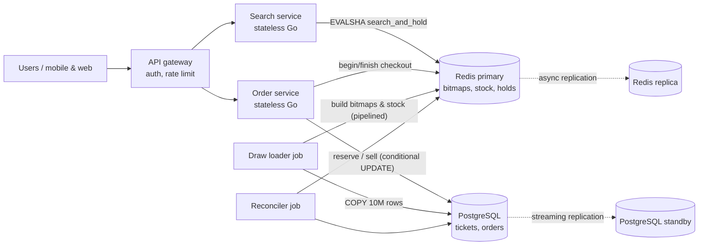
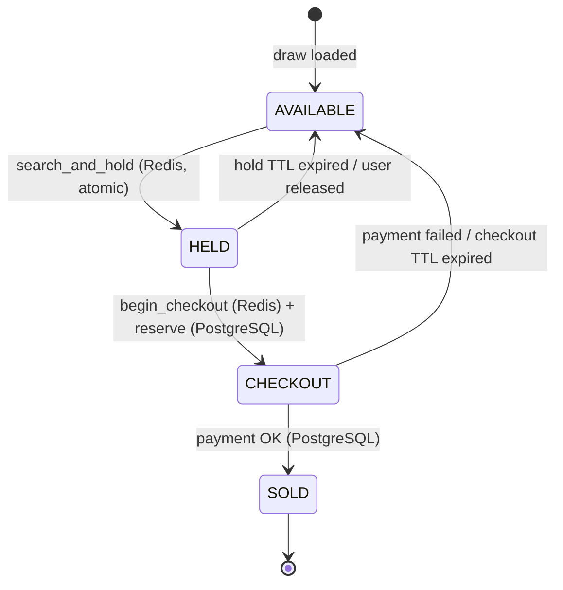
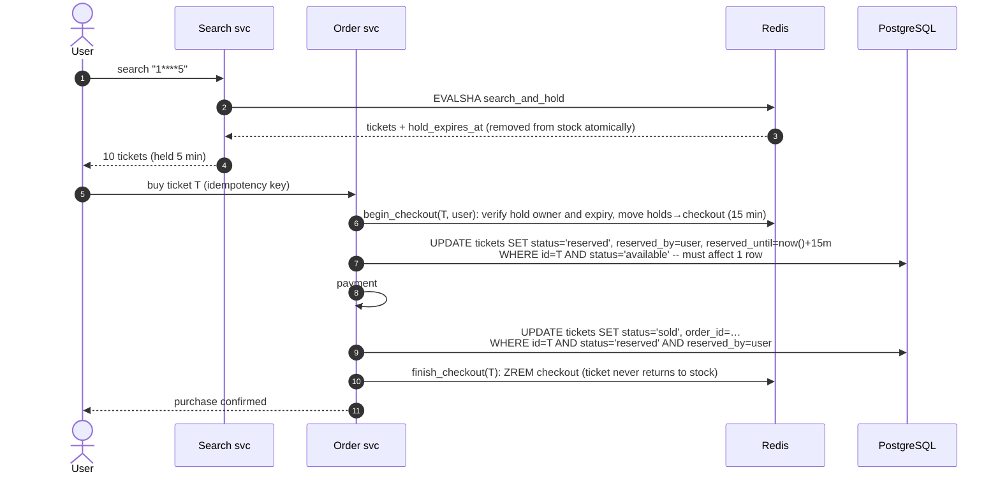

# Lottery Search System: Design Proposal

Part 2 of the Backend Golang Coding Test. This is a design document only; it contains no implementation.

## Contents

1. [Summary](#1-summary)
2. [Requirements and assumptions](#2-requirements-and-assumptions)
3. [Key observations](#3-key-observations)
4. [Architecture](#4-architecture)
5. [Data model](#5-data-model)
6. [Wildcard matching algorithm](#6-wildcard-matching-algorithm)
7. [Allocation and concurrency](#7-allocation-and-concurrency)
8. [Storage choice and justification](#8-storage-choice-and-justification)
9. [Performance analysis](#9-performance-analysis)
10. [Failure handling and operations](#10-failure-handling-and-operations)
11. [Alternatives considered](#11-alternatives-considered)
12. [Tradeoffs](#12-tradeoffs)

---

## 1. Summary

| Concern | Decision |
| --- | --- |
| System of record | **PostgreSQL** holds every ticket, its sale status and orders. Sales are guarded by conditional updates. |
| Search and allocation engine | **Redis**: one bitmap per index dimension over the 10⁶ possible numbers, plus a set of available tickets per number. |
| Wildcard matching | Bitwise `AND` of a precomputed *digit-position bitmap* for each fixed digit with an *availability bitmap*. Then a scan for set bits from a random offset. |
| No duplicate results | Search and reservation happen in **one atomic Redis Lua script**. A returned ticket is removed from the available pool and placed on a short **hold** (TTL) for that user, in the same step. |
| Cost per search | Bounded by the size of the *number space* (10⁶ bits = 125 KB per bitmap), **not the ticket count**. Measured at 48–163 µs mean inside Redis with 10M tickets loaded (§9). |

---

## 2. Requirements and assumptions

**From the brief**

- 10 million tickets, each with a 6-digit number.
- Search with a 6-character pattern of digits and `*` (for example `****23`, `1****5`, `123***`).
- The same pattern must not return the same ticket to multiple users at the same time.
- Searches must perform well at 10M+ records.

**Assumptions**

| # | Assumption | Why it matters |
| --- | --- | --- |
| A1 | A 6-digit number has only 10⁶ values (`000000`–`999999`). So 10M tickets means **about 10 physical tickets per number** on average, distinguished by a *set* (series) number. This is how printed lotteries such as the Thai Government Lottery work. A ticket's identity is `(draw, number, set)`. | Indexing is done per number (10⁶), not per ticket (10⁷). |
| A2 | A search returns a small page of tickets (default `N = 10`, max 50) for the user to choose from. It does not return every match. | Results can be allocated exclusively without starving other users. |
| A3 | "Not returned to multiple users at the same time" means: **while a ticket is shown to a user, no other user may receive it**. Once that user's hold expires or is released, the ticket may be shown to someone else. | This defines the hold / TTL semantics. |
| A4 | Ticket inventory for a draw is loaded once before sales open. After that it only shrinks as tickets are sold. | Position bitmaps are static; only availability changes. |
| A5 | Peak traffic is in the thousands of searches per second, around draw day. | Sizing in §9. |

---

## 3. Key observations

These four facts drive the design.

1. **The number space is small and dense.** There are only 10⁶ possible numbers, so a bitmap over all of them is just 125 KB. A full scan of such a bitmap takes microseconds and stays the same size whether there are 10M or 100M tickets.
2. **A pattern is a conjunction of per-position equalities.** For example, `1****5` means `digit₁ = 1 ∧ digit₆ = 5`. Each equality is a static set of numbers, so a match is the intersection of up to 6 precomputed sets.
3. **Patterns overlap.** `1****5`, `*****5` and `1*****` all contain `100005`. So a lock *per pattern* cannot satisfy the constraint, because two users with different patterns could still receive the same ticket. **Exclusivity must be per ticket.**
4. **Search and reservation must be one step.** If they are separate ("query, then lock what you found"), two users can read the same rows before either locks them. That requires retries, or `SELECT … FOR UPDATE` contention on popular patterns. Running the search inside the same atomic unit as the reservation removes the race entirely.

---

## 4. Architecture



| Component | Responsibility |
| --- | --- |
| **Search service** | Validates the pattern, picks a random start offset, and calls the `search_and_hold` script. Returns tickets with a hold expiry. Stateless and horizontally scalable. |
| **Order service** | Turns held tickets into a durable reservation and then a sale. PostgreSQL is the final authority on whether a ticket can be sold. |
| **Redis** | The *hot path*. It holds the matching index and the available pool, and allocates atomically. Everything in it can be **derived from PostgreSQL** and rebuilt. |
| **PostgreSQL** | The *system of record* for tickets, reservations and orders. It is durable, transactional and auditable. |
| **Draw loader** | Before sales open, bulk-loads tickets into PostgreSQL and builds the Redis structures. |
| **Reconciler** | Periodically releases expired checkouts and verifies that Redis and PostgreSQL agree (§10). |

---

## 5. Data model

### 5.1 PostgreSQL (system of record)

```text
tickets
  draw_id         int        ┐
  number          int        ├ PRIMARY KEY (draw_id, number, set_no)
  set_no          smallint   ┘
  status          enum('available','reserved','sold')
  reserved_by     bigint     null
  reserved_until  timestamptz null
  order_id        bigint     null
  INDEX (draw_id, status, reserved_until)   -- reconciler: expired reservations

orders
  id, user_id, draw_id, status, amount, idempotency_key UNIQUE, created_at, ...
```

There are about 10M rows per draw, roughly 1 GB including indexes. PostgreSQL does **not** do the wildcard search. It only answers "can *this* ticket be reserved or sold?" with single-row conditional updates on the primary key.

### 5.2 Redis (search and allocation)

All keys for one draw share the hash tag `{d}` so a single script can touch them atomically, including on Redis Cluster.

| Key | Type | Size | Meaning |
| --- | --- | --- | --- |
| `pos:{d}:<i>:<x>` (60 keys: 6 positions × 10 digits) | bitmap, 10⁶ bits | 125 KB each, **7.5 MB** total | bit `n` = 1 if digit `i` of `n` equals `x`. **Static.** Built once and never modified. |
| `avail:{d}` | bitmap, 10⁶ bits | **125 KB** | bit `n` = 1 if number `n` has at least one available ticket. |
| `stock:{d}:<n>` | set of `set_no` | ~100 B per number, **~100 MB** total | Available tickets of number `n`. |
| `holds:{d}` | sorted set: `ticket → expiry_ms` | per active hold | Tickets currently shown to a user (state HELD). |
| `holdinfo:{d}` | hash: `ticket → user_id` | per active hold | Who holds each ticket. |
| `uholds:{d}:<user>` | set | per active hold | A user's holds, for per-user caps. |
| `checkout:{d}` | sorted set: `ticket → expiry_ms` | per checkout | Tickets in payment (state CHECKOUT); the hold sweeper skips these. |
| `tmp:{d}` | bitmap | 125 KB | Scratch result of the current search. It is overwritten by each script; scripts never interleave. |

**Invariants.** These hold after every script.

- **I1:** Every unsold ticket is in exactly one of `stock`, `holds` or `checkout`.
- **I2:** `avail` bit `n` is 1 exactly when `stock:{d}:<n>` is non-empty.

> **Compact variant.** If the number of sets per number is at most 64, each `stock` set can be replaced by one 64-bit mask in a single `BITFIELD` key (10⁶ × 8 B = **8 MB** instead of ~100 MB). Popping a ticket becomes "clear the lowest or a random set bit". The baseline design keeps sets for generality.

### 5.3 Ticket lifecycle



HELD is **ephemeral** and lives only in Redis. CHECKOUT and SOLD are **durable** in PostgreSQL.

---

## 6. Wildcard matching algorithm

### 6.1 Parsing

A pattern must be exactly 6 characters from `[0-9*]`; anything else is rejected with `400`. Parsing produces:

- `F`: the set of fixed positions with their digits, for example `1****5 → {(1,'1'), (6,'5')}`
- `k = |F|`: the number of fixed digits. The number of matching *numbers* is `10^(6−k)`.

### 6.2 Strategy selection

| Class | Example | Matching numbers | Method |
| --- | --- | --- | --- |
| **Exact** (`k = 6`) | `123456` | 1 | `GETBIT avail n`, then pop from `stock:n`. |
| **Prefix** (fixed digits form a prefix) | `123***` | `10^(6−p)`, one **contiguous range** `[123000, 123999]` | `BITPOS avail 1 <start> <end> BIT` inside the range. No `BITOP` is needed. |
| **General** | `****23`, `1****5`, `1*3*5*` | `10^(6−k)`, scattered | `BITOP AND tmp avail pos[i][x] …` for each fixed position, then `BITPOS tmp 1 <offset>`. |
| **Any** (`k = 0`) | `******` | 10⁶ | `BITPOS avail 1 <offset>` directly. |

*Optional micro-optimisation:* when `k ≥ 4` (at most 100 candidates), reading the candidate bits with one multi-`GET` `BITFIELD` call can be cheaper than a `BITOP`. The threshold should be chosen by benchmark.

### 6.3 Worked example: `1****5`

```text
pos:{d}:1:1  = numbers 1xxxxx        (100,000 bits set)
pos:{d}:6:5  = numbers xxxxx5        (100,000 bits set)
avail:{d}    = numbers with stock    (≤ 1,000,000 bits set)

tmp = avail AND pos[1][1] AND pos[6][5]
    → numbers 1xxxx5 with stock      (≤ 10,000 bits set)

offset = random in [0, 10^6)   (supplied by the caller)
repeat BITPOS tmp 1 from offset (wrapping once) until N numbers are collected
for each number n: SPOP stock:{d}:n → set_no   ⇒ ticket (n, set_no)
```

The `BITOP` processes 3 × 125 KB, which is about 47,000 64-bit words. The scan for set bits touches at most 125 KB. **Neither depends on the number of tickets.**

### 6.4 Why a random starting offset

- **Fairness and spread.** Users searching the same popular pattern get results from different parts of the number space, instead of everyone being offered the "first" matches.
- **Less sold-out skew.** Inventory drains evenly across the space, rather than from the low numbers up.

The random offset is generated by the search service and passed as a script argument. This keeps the script deterministic and independent of how Redis seeds Lua's random number generator, and it also makes a given search reproducible in tests.

### 6.5 Counting matches

`BITCOUNT tmp` returns how many *numbers* matching the pattern are still available, in one more pass over at most 125 KB. This supports UI text such as "1,284 numbers available".

---

## 7. Allocation and concurrency

### 7.1 `search_and_hold`: one atomic script

Inputs: `draw, pattern, N, user, hold_ttl, random_offset`.

```text
1. now ← TIME                                          (Redis clock, not the client's)
2. Sweep: up to 200 entries of holds with score ≤ now
       → SADD stock:n set_no, SETBIT avail n 1, HDEL holdinfo, SREM uholds  (I1, I2)
3. Enforce per-user cap: |uholds:user| + N ≤ MAX_HOLDS, else return error / fewer
4. Build the candidate bitmap (§6.2)
5. Collect up to N numbers via BITPOS from random_offset (wrap once)
6. For each number n:
       set_no ← SPOP stock:n
       if stock:n is now empty → SETBIT avail n 0                                 (I2)
       ZADD holds (now + hold_ttl) ticket; HSET holdinfo ticket user; SADD uholds:user ticket
7. Return [(number, set_no)], hold_expires_at
```

The hold TTL is short (for example 5 minutes) and is configurable.

### 7.2 Why duplicates are impossible

- Redis runs each Lua script **to completion before running any other command**. Script executions therefore never interleave.
- Step 6 removes the ticket from `stock` (with `SPOP`) **in the same script** that selected it. Any later script, from any user and with any pattern, sees the ticket as gone.
- So, by invariant I1, a ticket is held by **at most one user at any instant**, **regardless of which pattern** found it. This is stronger than the brief's "same pattern" requirement, and it is necessary because patterns overlap (§3, point 3).
- There are no locks, retries or "check then act" gaps. Two concurrent searches for `****23` simply receive disjoint tickets in the order Redis runs them.

### 7.3 Releasing tickets

| Trigger | Action |
| --- | --- |
| User deselects or closes results | `release` script: removes the user's holds and returns the tickets to `stock`. |
| User searches again | Previous unselected holds for that user are released first (configurable), so idle holds do not pile up. |
| Hold TTL passes | Lazy sweep at the start of every script (step 2), plus a periodic sweeper. Hold release is therefore not driven by keyspace notifications, which are fire-and-forget and can be lost. |

### 7.4 Purchase flow and the durability boundary



**Defence in depth.**

- Redis guarantees *exclusive display*.
- PostgreSQL guarantees *exclusive sale*. Every state change is a conditional `UPDATE` on one primary key, and the affected-row count must be 1. Even if Redis lost data (§10), a ticket could never be sold twice.
- Ordering rule: when tickets return to the pool, **PostgreSQL is updated first, then Redis**. `stock` therefore never offers a ticket that PostgreSQL considers reserved or sold.
- If payment finishes after the checkout expired, the reconciler's `UPDATE … WHERE status='reserved' AND reserved_until < now()` and the payment's `UPDATE … SET status='sold'` contend for the same row lock. Exactly one wins; if the reconciler wins, the payment is voided or refunded.

### 7.5 Abuse and hoarding

Holds make inventory temporarily invisible, so a bot could repeatedly search a popular pattern to block it. Mitigations:

- a per-user cap on concurrent holds (`MAX_HOLDS`, for example 20)
- gateway rate limiting per user and IP
- a short hold TTL
- releasing previous holds on a new search
- `N` capped at 50

---

## 8. Storage choice and justification

### Recommendation: **PostgreSQL (system of record) + Redis (search and allocation engine)**

| Criterion | How the choice satisfies it |
| --- | --- |
| **Query performance** | All matching state for a draw (about 8 MB of bitmaps plus about 100 MB of stock) lives in Redis memory. Wildcard search becomes a few bitwise operations over 125 KB bitmaps (§9), with no disk I/O and no scanning of 10M rows. |
| **Concurrency handling** | Redis executes Lua scripts serially, so search-and-reserve is **atomic by construction**, without row locks, lock queues or retry loops. PostgreSQL adds ACID guarantees for money-related state. |
| **Correctness under failure** | Holds are ephemeral by design. Losing them only means a user searches again. Sales are protected by PostgreSQL conditional updates. |
| **Operational simplicity** | Both are mainstream with managed offerings (for example RDS/Cloud SQL and ElastiCache/Memorystore) and well-understood backup, replication and monitoring. They need no exotic engine or custom consensus. Redis state is **fully rebuildable** from PostgreSQL. |
| **Cost** | One modest Redis primary and replica (about 1 GB RAM per draw is ample) and one PostgreSQL primary and standby. |

### Options compared

| Option | Wildcard search | Atomic exclusive allocation | Verdict |
| --- | --- | --- | --- |
| **PostgreSQL only** (`FOR UPDATE SKIP LOCKED`) | Needs per-digit columns with BitmapAnd, or many indexes (§11). Tens of ms for 1–2 fixed digits. | Yes, row locks with `SKIP LOCKED`. | Correct and simple. Good for low traffic, but hot patterns contend on the same rows, and holds cause heavy WAL and vacuum churn. |
| **MongoDB** | Per-digit fields plus compound indexes; leading wildcards are hard to index. | Per document (`findOneAndUpdate`), one ticket per round trip. | Workable, with similar indexing limits to PostgreSQL and more round trips. |
| **Elasticsearch / OpenSearch** | Fast wildcard and term queries. | **No.** Search is near-real-time (about 1 s refresh) and has no atomic "search and claim". | Unsuitable for exclusive allocation. |
| **Redis + PostgreSQL** *(chosen)* | Bitwise operations over 125 KB bitmaps, in microseconds. | Yes, one Lua script performs search and claim together. | Best latency, strong concurrency semantics and a durable source of truth. |

---

## 9. Performance analysis

### 9.1 Memory (per draw)

Sizes were measured with `INFO memory` (`used_memory`) on Redis 7.4 after loading 10M tickets (§9.4). Holds were not measured and remain an estimate.

| Structure | Expected | Measured |
| --- | --- | --- |
| Position bitmaps (60 × 125 KB) + availability bitmap | 7.6 MB | **7.8 MB** |
| Stock sets (10⁶ numbers × 10 sets) | about 100 MB (or 8 MB with the 64-bit mask variant) | **99.6 MB** (`MEMORY USAGE` of one set: 96 B) |
| Holds (for example 100k concurrent holds × about 150 B) | about 15 MB | not measured |
| **Total** | about 125 MB | **108.4 MB** before holds, which fits comfortably in a small Redis instance. |

Loading all 10M tickets from scratch took about **4 s** (bitmaps built client-side and written with `SET`, stock written with pipelined `SADD`).

### 9.2 Time per search (inside Redis)

Measured server-side for `search_and_hold` with N = 10, 2,000 searches per class with random digits and random offsets, and the stock released after each search so every search saw full inventory. "Mean" is `usec_per_call` from `INFO commandstats`; percentiles are from `INFO latencystats`.

| Pattern class | Method | Mean | p50 | p99 | p99.9 |
| --- | --- | --- | --- | --- | --- |
| Exact `123456` (k=6, returns 1 ticket) | `BITPOS` on a 1-bit range (same as `GETBIT`) | 48 µs | 50 µs | 87 µs | 127 µs |
| Any `******` (k=0) | `BITPOS avail` | 104 µs | 101 µs | 184 µs | 264 µs |
| Prefix `123***` (k=3) | `BITPOS` on a range, no `BITOP` | 107 µs | 102 µs | 199 µs | 264 µs |
| General `1****5` (k=2) | `BITOP` over 3 bitmaps | 137 µs | 132 µs | 219 µs | 324 µs |
| Suffix `****23` (k=2) | `BITOP` over 3 bitmaps | 139 µs | 134 µs | 239 µs | 330 µs |
| General `1*3*5*` (k=3) | `BITOP` over 4 bitmaps | 147 µs | 142 µs | 232 µs | 334 µs |
| General `12**56` (k=4) | `BITOP` over 5 bitmaps | 163 µs | 158 µs | 257 µs | 426 µs |

What the numbers show:

- **Script total: 48–163 µs mean, p99 ≤ 257 µs**, inside the 50–200 µs originally estimated.
- **Allocation dominates, not search.** The no-`BITOP` classes (any, prefix) cost about 105 µs for 10 tickets, against 48 µs for one ticket. So each held ticket costs about 6 µs (`SPOP`, `SCARD`, `ZADD`, `HSET`, `SADD`).
- **`BITOP` adds about 30–55 µs**, growing with the number of fixed digits. `k = 4` is the slowest class, so it is the first candidate for the `BITFIELD` micro-optimisation in §6.2.
- **Search cost did not depend on the ticket count.** No step touches more than a few 125 KB bitmaps.

### 9.3 Throughput and correctness under concurrency

| Test | Result |
| --- | --- |
| 64 clients, mixed pattern classes, 10 s, no release | **6,555 searches/s** reached (65,547 searches, 571,974 tickets held). Server time 123 µs per call, so the single-threaded ceiling is **about 8,100 searches/s per shard**. Redis was about 80% busy; the rest was client and Docker Desktop network overhead. |
| 200 clients searching `7****3` until it sold out | 10,204 searches handed out **exactly 100,000 tickets, with 0 duplicates** and every ticket matching the pattern, in 1.6 s. |
| Hold expiry | 10 tickets of one number held with a 300 ms TTL. A search before expiry returned none; a search after expiry got one back through the lazy sweep. |

- **End-to-end latency** is dominated by the network. In the test setup (client on the Windows host, Redis in Docker Desktop) the client p50 was about 0.5 ms for every class; in production expect about 1–3 ms p50 from the search service.

### 9.4 Benchmark method

- **Environment:** Redis 7.4.11 in Docker Desktop (WSL 2) on Windows 11, AMD Ryzen 7 5825U (8 cores, 16 threads). Persistence off. The Go client (go-redis v9) ran on the same host.
- **Data:** one draw with 10⁶ numbers × 10 sets = 10M tickets, using the key layout in §5.2.
- **Scripts:** `search_and_hold` implemented as specified in §6.2 and §7.1 (sweep, per-user cap, strategy selection, `BITPOS` from a random offset with one wrap, atomic `SPOP` and hold), plus a `release` script (§7.3).
- **Timing:** server-side only, from `INFO commandstats` and `INFO latencystats`, reset before each class. Scripts that release stock ran through `EVAL` so they were not counted with the searches (`EVALSHA`). `SLOWLOG` was not used because it also logs every command inside a script, which inflates timings.
- The prototype is not in this repository, because Part 2 is a design exercise. Numbers come from a laptop and are indicative; a production sizing run should use the target hardware with the client on a separate host.

**Complexity.** For a pattern with `k` fixed digits:

- time `O(k · S / w)`, where `S = 10⁶` is the size of the number space and `w = 64` is the machine word size
- independent of the ticket count `T`.

A naïve table scan with `LIKE '1____5'` costs `O(T)`, which is 10⁷ rows per query and takes seconds. A B-tree on `number` only helps for prefix patterns.

### 9.5 Scaling beyond one shard

- **More tickets per number** (for example 100M tickets) changes only the stock size. Search cost stays the same.
- **More traffic:** partition the *number space* across `S` Redis primaries (for example by `n mod S`), each with its own bitmaps over its own numbers.
  - A search goes to one shard, chosen at random, and falls through to the next only if it found fewer than `N` results. Searches therefore remain single-shard and atomic in the common case.
  - Each ticket lives on exactly one shard, so the no-duplicate guarantee is unchanged.
- **More draws:** each draw is an independent key family (hash tag `{d}`) and can be placed on a separate shard.

---

## 10. Failure handling and operations

| Scenario | Behaviour |
| --- | --- |
| **Redis primary failover** (async replication can lose the last writes) | Some recent holds may be lost or revived. Users may lose a hold and need to search again. A ticket could briefly appear in `stock` while it is in checkout; `begin_checkout` then fails at the PostgreSQL conditional update, so **no double sale**. The reconciler repairs the drift. |
| **Redis total loss** | Rebuild from PostgreSQL: stream the `available` tickets (10M rows → seconds to tens of seconds) and pipeline `SADD` / `SETBIT`. Position bitmaps are static and can be loaded from a snapshot. Searches return `503` during the rebuild, which is acceptable for a sale, unlike corrupted inventory. |
| **PostgreSQL failover** | Search keeps working. Checkout pauses until the standby is promoted; holds absorb the gap. |
| **Payment slower than checkout TTL** | The row-lock race described in §7.4 resolves it; the loser voids or refunds. |
| **Clock skew** | Hold expiry uses Redis `TIME`; reservation expiry uses PostgreSQL `now()`. Application server clocks are never trusted. |

### Reconciler (every minute)

1. In PostgreSQL, set `reserved` rows with `reserved_until < now()` back to `available`. Then, in Redis, return those tickets to `stock` (`ZREM checkout`, `SADD`, `SETBIT`), keeping the PostgreSQL-first ordering rule.
2. Spot-check invariant I2 on a sample of numbers, and compare `BITCOUNT avail` with PostgreSQL counts. Alert if they drift.

### Draw lifecycle

- **Load:** `COPY` 10M rows into PostgreSQL in under about a minute. Build Redis structures with pipelined writes. Flip the draw to *open*.
- **Close:** reject new searches, let checkouts finish or expire, then drop the `{d}` keys from Redis.

### Observability

Track the following metrics:

- script latency (p50/p99), holds created and expired, and hold-to-purchase conversion
- the counts of zero-result and partial-result searches
- reconciler drift
- the PostgreSQL conditional-update failure rate. This should be about 0; a spike means Redis and PostgreSQL disagree.

---

## 11. Alternatives considered

### 11.1 PostgreSQL only, with "permutation prefix" indexes

A B-tree on `number` serves prefix patterns (`123***`) with one range scan, but not `****23`. A wildcard pattern is defined by its *set of fixed positions*, and there are 2⁶ = 64 such sets. If an index stores the digits in an order where the fixed positions come first, any pattern becomes a **single range scan**.

The question is how many digit orders are needed to cover all 64 sets. Each order (permutation) defines a maximal chain `∅ ⊂ {p₁} ⊂ {p₁,p₂} ⊂ …` in the subset lattice, so the minimum is the number of chains that cover the lattice. By Dilworth's theorem and Sperner's theorem, that is the width of the lattice, `C(6,3) = 20`. A *symmetric chain decomposition* achieves it.

So **20 expression indexes** on permuted digit strings make every wildcard pattern a single index range scan. Combined with `FOR UPDATE SKIP LOCKED LIMIT N` and a random start key, this is a correct PostgreSQL-only design.

It was rejected as the primary design for three reasons:

- 20 indexes on 10M rows amount to several GB, and they slow the bulk load.
- Every hold is a row update, which produces WAL and vacuum churn at thousands of updates per second.
- Popular patterns contend on adjacent index ranges.

It remains a sound **fallback**, or a **phase-1** design for low traffic.

### 11.2 A custom in-memory Go service

The same bitmap algorithm can run in-process (for example with roaring bitmaps and a single-writer goroutine per shard). That is faster still, because it avoids the network hop. However, replication, failover, persistence and operational tooling would all have to be built by hand. Redis provides these off the shelf.

### 11.3 Locking per pattern

The idea is to serialise all searches of the same pattern through a mutex or queue. This is **incorrect on its own**, because different patterns overlap (§3), and it also creates a hot lock on popular patterns. Per-ticket atomic removal is both simpler and correct.

### 11.4 Precomputing results per pattern

There are 11⁶ ≈ 1.77M possible patterns, and every sale would need to update every pattern that matches the ticket's number (2⁶ = 64 patterns per number). This approach is far more memory and write work than the bitmaps, for no gain.

---

## 12. Tradeoffs

| Choice | Benefit | Cost / risk | Mitigation |
| --- | --- | --- | --- |
| Allocate on search (holds) | Hard guarantee of no simultaneous duplicates | Shown tickets are temporarily unavailable to others | Short TTL, small `N`, per-user caps, release on re-search |
| Redis as the hot path | Microsecond search, atomic scripts | Two stores to keep consistent; holds can be lost on failover | PostgreSQL is authoritative; PostgreSQL-first ordering; reconciler; Redis is rebuildable |
| Serial script execution | Trivially correct concurrency | Single-shard throughput ceiling (about 8k/s measured) | Bounded script work; shard the number space |
| Random start offset | Fair, spread-out results | Results are not sorted | Sort the returned page client-side if needed |
| Stock as sets per number | General (any number of sets) | ~100 MB vs 8 MB | Switch to 64-bit masks when sets per number ≤ 64 |
